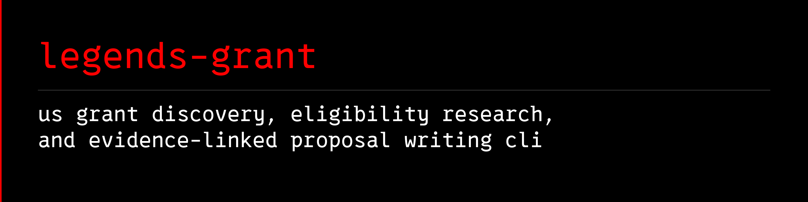
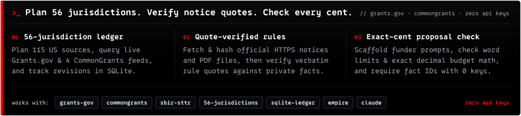
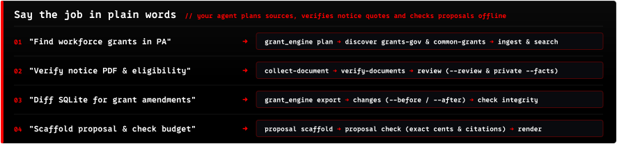
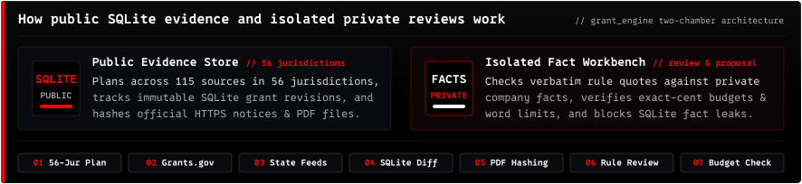
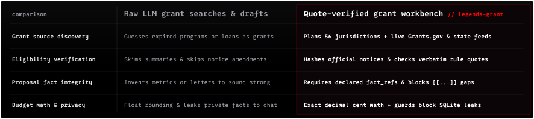

# 

[](https://github.com/avalonreset/legends-grant/releases/latest)
[](https://github.com/avalonreset/legends-grant/actions/workflows/runtime.yml)
[](https://github.com/avalonreset/legends-grant/actions/workflows/contract.yml)
[](grant_engine/data/us-sources.json)
[](LICENSE)

**US grant discovery CLI (`grant_engine`), append-only SQLite evidence store, verbatim quote-verified eligibility matcher, and exact-cent proposal checker for coding agents across federal (`Grants.gov`), state (`CommonGrants`), local, tribal, and foundation funding with zero API keys.**


```text
Install or update legends-grant via cto-legends (https://github.com/avalonreset/cto-legends): run `cto-legends install legends-grant --apply`, then `cto-legends handoff legends-grant` and follow the returned JSON recipe to verify `python -m grant_engine doctor`.
```



## Why `legends-grant` exists

Most AI grant discovery and proposal tools fail on three predictable traps:

1. **Expired programs and federal-only bias:** Asking a raw language model to find small business grants or SBIR opportunities produces outdated program names from training memory, confuses loans or historical awards with open non-dilutive grants, and ignores state, municipal, tribal, and regional funding boards.
2. **Skimmed summaries instead of controlling notice text:** An unguided agent reads a short feed blurb and declares your organization eligible without fetching the official Notice of Funding Opportunity (NOFO), checking recent amendments, or verifying whether a disqualifying clause applies to your entity type or cash match.
3. **Invented metrics, rounding errors, and leaked company facts:** When drafting an application, a raw chat window routinely invents customer metrics or partnerships to sound persuasive, introduces floating-point rounding mismatches in budget tables, and mixes confidential company financials or tax identifiers into shared public context.

`legends-grant` gives your coding agent a deterministic Python runtime (`python -m grant_engine`, zero paid API keys required) built around a strict **two-chamber architecture**: public funding evidence lives in an immutable local SQLite ledger, while your confidential company facts, eligibility assessments, and proposal drafts stay in separate private case files protected by database magic-byte, hardlink, and symlink guards.

## Ask in plain english

Once [`cto-legends`](https://github.com/avalonreset/cto-legends) is installed, you ask your coding agent in plain english. It builds a jurisdiction-matched discovery plan, queries public feeds, hashes official notices, and checks your proposal offline:



## Architecture: public SQLite ledger and isolated private review



### 1. 56-jurisdiction discovery planning and append-only SQLite evidence (`plan`, `discover`, `ingest`, `changes`)

Rather than defaulting to federal-only search, `grant_engine plan` routes across a researched 115-source registry (`grant_engine/data/us-sources.json`) covering all 50 US states, Washington DC, 5 US territories (`AS`, `GU`, `MP`, `PR`, `VI`), and national routes:

- **Live no-key feed adapters (`discover`):** Queries bounded public federal opportunities and full details directly from `Grants.gov` (`discover grants-gov --query ...`) and consumes four vetted state `CommonGrants` feeds (`California`, `Pennsylvania`, `Washington`, and `Maryland` via `discover common-grants`), while emitting structured `agent_research` tasks for state and foundation portals without public APIs.
- **Immutable SQLite revision ledger (`ingest`, `search`, `changes`, `check`):** Stores public opportunity records in an append-only SQLite database protected by SQL triggers (`revision_no_update`, `observation_no_update`, `run_no_update`). Refresh observations never overwrite newer amendments, feed outages never falsely mark an open grant as closed (`closure_inferred: false`), and `grant_engine changes --before ... --after ...` pinpoints material deadline or rule changes across snapshots.

### 2. SSRF-hardened notice collection and verbatim quote-verified eligibility (`collect-document`, `review`)

Feed summaries and third-party state portals are leads, not governing legal terms. Before assessing eligibility, your agent collects the official notice and evaluates reviewed rules against your private facts file:

| Surface | `grant_engine` Subcommands | What It Enforces |
| :--- | :--- | :--- |
| **Nationwide Planning & Feed Discovery** | `doctor`, `sources`, `plan`, `discover` | Offline registry verification across 56 US jurisdictions, applicant- and purpose-led source ranking, and bounded no-key `grants-gov` and `common-grants` retrieval. |
| **SQLite Evidence Ledger & Diffing** | `ingest`, `search`, `report`, `export`, `replay`, `changes`, `check` | Append-only SQLite storage with source-authority and funding-instrument labels (`loan_or_mixed_instrument`), snapshot diffing, and cryptographic index verification. |
| **Official Notice & PDF Collection** | `collect-document`, `verify-documents` | Downloads explicit public HTTPS notices and PDF attachments with DNS-pinned SSRF protection (blocking private IPs, NAT64, 6to4, Teredo, and credentialed URLs), content-addressed SHA-256 receipts, link inventories, and bounded subprocess PDF extraction. |
| **Verbatim Quote Eligibility Matcher** | `review` | Evaluates reviewed rules (`--review`) against separate private applicant facts (`--facts`). Verifies that every cited rule quote appears verbatim inside a hash-verified, authoritative official notice; any stale document, missing attachment, or unknown fact forces an `unresolved` verdict. |
| **Exact-Cent Proposal Workbench** | `proposal init`, `scaffold`, `check`, `render` | Scaffolds funder questions and private facts, enforces word limits and exact `Decimal` cent arithmetic across grant and match budget lines, requires declared `fact_refs` on every answer, blocks unresolved `[[...]]` or `TBD` placeholders, and renders a private Markdown package. |

### 3. Deterministic proposal verification and private data isolation (`proposal`)

When you move from qualification to drafting, the agent writes the narrative prose while `grant_engine proposal check` enforces mechanical truth gates:

- **Declared fact citations and visible gaps:** Every narrative answer must cite one or more declared fact IDs from your private facts JSON (`historical`, `estimate`, or `commitment`). When a figure or attachment is missing, the workflow keeps an explicit open placeholder (`[[OPEN: ...]]`) rather than inventing filler, and the checker blocks completion until every placeholder and required attachment is resolved.
- **Exact decimal budget math and SQLite isolation:** Budget lines use exact decimal cent arithmetic (`Decimal("0.01")`) rather than floating-point math, verifying `grant_lines_sum`, `all_lines_sum`, `max_request` ceilings, and unallowable cost categories. File-identity, symlink, and SQLite magic-byte guards (`SQLite format 3\x00`) refuse any command that attempts to write private facts or proposal outputs into a public evidence database.

## Raw LLM grant searches vs `legends-grant`



## Quick start

```sh
# 1. Install the runtime (add .[pdf] for local pypdf text extraction) and check readiness
python -m pip install ".[pdf]"
python -m grant_engine doctor

# 2. Build a jurisdiction and applicant discovery plan across the 56-jurisdiction registry
python -m grant_engine plan --jurisdiction PA --applicant-type business --purpose workforce --output plan.json

# 3. Query live public Grants.gov and state CommonGrants feeds (zero API keys)
python -m grant_engine discover grants-gov --query "workforce training" --limit 5 --output federal-sample.json
python -m grant_engine discover common-grants --base-url https://pa.api.cg.a6lab.ai --source-id commongrants-pa --limit 5 --output pa-sample.json

# 4. Ingest into the append-only SQLite evidence store, search offline, and verify integrity
python -m grant_engine ingest --db evidence.sqlite --input federal-sample.json
python -m grant_engine ingest --db evidence.sqlite --input pa-sample.json
python -m grant_engine search --db evidence.sqlite --query workforce --status open --jurisdiction PA
python -m grant_engine check --db evidence.sqlite

# 5. Evaluate quote-verified eligibility rules and check an offline proposal package
python -m grant_engine review --review examples/qualification-review.json --facts examples/qualification-facts.json --as-of 2030-10-02T12:00:00Z --output review-result.json
python -m grant_engine proposal check --proposal examples/proposal.json --facts examples/proposal-facts.json
```

## Reference

<details>
<summary><strong>Notice collection, eligibility review, and proposal writing workflows</strong></summary>

Public opportunity evidence in `evidence.sqlite` must always stay separate from private applicant facts (which can be sourced from [`legends-empire`](https://github.com/avalonreset/legends-empire) or local client files):

```sh
# Collect and verify an official HTTPS notice and its linked attachments
python -m grant_engine collect-document --url https://example.gov/nofo.pdf --bundle ./notices/opp-1
python -m grant_engine verify-documents --bundle ./notices/opp-1

# Compare two SQLite evidence exports to detect deadline or status amendments
python -m grant_engine export --db evidence.sqlite --output snapshot-before.json
python -m grant_engine changes --before snapshot-before.json --after snapshot-after.json

# Scaffold, check, and render a private grant proposal draft
python -m grant_engine proposal scaffold --opportunity-id opp-1 --proposal-out proposal.json --facts-out proposal-facts.json
python -m grant_engine proposal check --proposal proposal.json --facts proposal-facts.json
python -m grant_engine proposal render --proposal proposal.json --facts proposal-facts.json --output proposal-draft.md
```

Read the complete workflow guides in `docs/`:
- [Agent entry point](docs/GRANT-RECIPE.md) and [CLI command reference](docs/AGENT-RECIPE.md)
- [Runtime guide](docs/RUNTIME.md), [qualification rules](docs/QUALIFICATION.md), and [proposal writing workflow](docs/PROPOSAL-WRITING.md)
- [Nationwide architecture](docs/NATIONWIDE-DESIGN.md), [source research](docs/SOURCE-RESEARCH.md), [coverage and known gaps](docs/COVERAGE.md), and [search strategy](docs/SEARCH-STRATEGY.md)
- [Verification receipt](docs/VERIFICATION.md), [discovery battle test](docs/BATTLE-TEST-2026-10-02.md), and [proposal battle test](docs/PROPOSAL-BATTLE-TEST.md)
- Stage guides: [search](find.md), [match](match.md), [qualify](qualify.md), and [apply](apply.md)

</details>

<details>
<summary><strong>Credits and upstream projects</strong></summary>

Thank you to the maintainers whose public data services and open-source work informed this module. We distinguish public feeds and libraries used by the runtime from projects consulted during design:

| Project or service | Contribution to this project |
| :--- | :--- |
| [Agile Six CommonGrants grant seeker](https://github.com/agilesix/cg-mcp-grant-seeker), with its [California](https://github.com/agilesix/cg-api-ca), [Pennsylvania](https://github.com/agilesix/cg-api-pa), [Washington](https://github.com/agilesix/cg-api-wa), and [Maryland](https://github.com/agilesix/cg-api-md) adapters | Operates the four public state feeds consumed by our Python adapter. Their collection infrastructure provides the data; we did not build those upstream feeds. |
| [CommonGrants](https://commongrants.org/) and [HHS Simpler.Grants.gov](https://github.com/HHS/simpler-grants-gov) | The interchange format used by those feeds, and a reference for normalization and preserving original source evidence. |
| [OpenProse grant-finder](https://github.com/openprose/grant-finder) | Design reference for evidence ledgers, structured research packets, and reproducible collection. Its Go implementation is not incorporated. |
| [cyanheads Grants.gov MCP](https://github.com/cyanheads/grantsgov-mcp-server) and [GSA-TTS Grants.gov MCP](https://github.com/GSA-TTS/mcp-server-grants-gov) | References for federal API fields, filtering, validation, and pagination. Their server implementations are not incorporated. |
| [Grants.gov](https://www.grants.gov/) | Original federal opportunity data, retrieved directly through its public API. |
| [pypdf](https://github.com/py-pdf/pypdf) | Optional installed dependency that performs local PDF text extraction. |
| [eseckel/ai-for-grant-writing](https://github.com/eseckel/ai-for-grant-writing) (CC-BY-4.0) | Curated grant-writing resources whose methods we distilled into our proposal workflow; no upstream text copied. |
| [AIScientists-Dev/academic-humanizer](https://github.com/AIScientists-Dev/academic-humanizer) (LICENSE states MIT) | Editing and claim-evidence ideas adapted into selective, plain-voice revision guidance; no upstream text copied. |

No implementation code from the grant-discovery projects above is vendored in this repository. Feed consumption, design references, and the optional PDF dependency are distinct forms of reuse. This project is independently maintained; these credits do not imply partnership, endorsement, or official state verification. Our MIT license covers our code, not ownership of upstream data or documents; upstream materials retain their own terms and notices. See [source research and adoption decisions](docs/SOURCE-RESEARCH.md#github-reuse-and-verified-third-party-state-feeds) and [THIRD_PARTY_NOTICES.md](THIRD_PARTY_NOTICES.md).

</details>

<details>
<summary><strong>Agent setup (via <code>cto-legends</code>) and standalone installation</strong></summary>

### Agent setup (via `cto-legends`)

Part of [cto-legends](https://github.com/avalonreset/cto-legends). `cto-legends` is the only registered skill; this repo vendors a pinned copy at [skills/cto-legends/SKILL.md](skills/cto-legends/SKILL.md). Do not register this module as its own skill.

Run `cto-legends handoff legends-grant` and follow the returned JSON recipe and readiness checks. To install or update through the router, preview with `cto-legends install legends-grant`, apply with `cto-legends install legends-grant --apply`, or sync and update with `cto-legends sync --apply` and `cto-legends update legends-grant --apply`. Keep SQLite evidence databases and private client files outside the replaceable installation directory.

```sh
python -m pip install ".[pdf]"
python -m grant_engine doctor
```

</details>

<details>
<summary><strong>Repository layout, verification, and scope limits</strong></summary>

```text
Applicant & Jurisdiction Plan (`grant_engine plan`)
  -> Public adapters (`grants-gov`, `common-grants`, HTTPS `collect-document`)
  -> Immutable SQLite evidence store (`ingest`, `search`, `changes`, `report`, `check`)
  -> Isolated private eligibility review (`review`) & proposal workbench (`proposal`)
```

- `grant_engine/`: Standard-library Python 3.11+ runtime (`__main__.py`, `core.py`, `grants_gov.py`, `common_grants.py`, `documents.py`, `search.py`, `qualification.py`, `proposals.py`, and bundled `data/us-sources.json`).
- `docs/`: [Grant recipe](docs/GRANT-RECIPE.md), [agent recipe](docs/AGENT-RECIPE.md), [runtime guide](docs/RUNTIME.md), [qualification spec](docs/QUALIFICATION.md), and [proposal workflow](docs/PROPOSAL-WRITING.md).
- `skills/cto-legends/SKILL.md`: Pinned copy of the central [`cto-legends`](https://github.com/avalonreset/cto-legends) router skill.

```sh
python -m unittest discover -s tests -v
python scripts/render_cards.py
python scripts/check_release.py
```

The runtime does not autonomously discover every grant nationwide, extract legal rules without human or agent review, guarantee qualification or funding awards, or submit applications automatically. State CommonGrants feeds require official notice verification, and `--limit` bounds retrieval.

</details>

## Contributing, security, and license

See [CONTRIBUTING.md](CONTRIBUTING.md), [SUPPORT.md](SUPPORT.md), and [SECURITY.md](SECURITY.md).

MIT License. See [LICENSE](LICENSE), [NOTICE](NOTICE), and [THIRD_PARTY_NOTICES.md](THIRD_PARTY_NOTICES.md). Copyright (c) 2026 Avalon Reset.

[](https://github.com/avalonreset/cto-legends/issues/new?title=Message%20for%20Avalon%20Reset&labels=message)

<p align="center"><a href="https://github.com/stars/avalonreset/lists/cto-legends"></a></p>

**Specification & benchmarks on cto-legends.com:**
- **Module specification & architecture matrix:** [cto-legends.com/modules/legends-grant](https://cto-legends.com/modules/legends-grant)
- **Related engineering dispatches:** [AI Agent Governance: Markdown Knowledge Base & Vault Architecture](https://cto-legends.com/blog?post=ai-agent-governance) · [How to Build AI Agents: Production CLI & MCP Routing](https://cto-legends.com/blog?post=how-to-build-ai-agents-cli-mcp-routing) · [Claude Code Skills: MCP vs CLI Workflow Architecture](https://cto-legends.com/blog?post=claude-code-skills-mcp-vs-cli-workflow)
- **Ecosystem hub:** [cto-legends.com/home](https://cto-legends.com/home)
