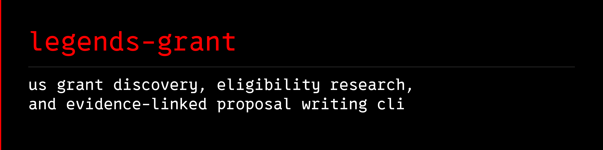

# 

[](https://github.com/avalonreset/legends-grant/releases/latest)
[](https://github.com/avalonreset/legends-grant/actions/workflows/ci.yml)
[](LICENSE)

**US grant discovery CLI (`grant_engine`), SQLite evidence store, and proposal verification workbench for AI agents across federal (`Grants.gov`), state (`CommonGrants`), local, tribal, and foundation funding.**

## What v0.3.2 does

- A researched nationwide source registry, including all 50 states, DC and five
  territories. Registry coverage is not exhaustive opportunity coverage.
- Source planning, including explicit research tasks for sources without adapters.
- Bounded public Grants.gov search and detail retrieval.
- Public CommonGrants discovery from four vetted third-party state feeds:
  California, Pennsylvania, Washington and Maryland.
- A local SQLite evidence store with immutable revisions, collection receipts,
  export, replay and integrity checks.
- Offline keyword search across collected evidence, with visible status,
  source authority and freshness warnings.
- Bounded collection of explicit public HTTPS notices and attachments, saved
  bytes, extracted text, link inventory and offline artifact verification.
- Evidence-linked review of agent-prepared requirements against separate
  applicant facts, with conservative unresolved results and an application checklist.
- Comparison of evidence exports to flag changes for re-review.

## Proposal workbench

- Offline `proposal` commands scaffold a draft package, check
  deterministic constraints (word limits, budget arithmetic, citation
  references, placeholder screens), flag claim mentions for advisory
  manual review, and render a private review draft. The agent writes
  the actual narrative text; the checker never scores quality or
  predicts awards. See
  [the proposal writing workflow](docs/PROPOSAL-WRITING.md).

The agent chooses sources, reads governing terms and prepares the review.
The runtime does not autonomously discover every grant, extract every eligibility
rule, guarantee qualification, or submit applications. State feeds require official
notice verification. A successful document download does not prove the notice
inventory is complete. No paid provider or Alexandria dependency is required.

## Quick start

Python 3.11 or newer; core runtime uses only the standard library. From this directory:

```powershell
python -m pip install .
python -m grant_engine doctor
python -m grant_engine plan --jurisdiction TX --applicant-type nonprofit --purpose housing
python -m grant_engine discover grants-gov --query workforce --limit 3 --output federal-sample.json
python -m grant_engine discover common-grants --base-url https://ca.api.cg.a6lab.ai --source-id commongrants-ca --limit 3 --output ca-sample.json
python -m grant_engine ingest --db evidence.sqlite --input federal-sample.json
python -m grant_engine ingest --db evidence.sqlite --input ca-sample.json
python -m grant_engine report --db evidence.sqlite
python -m grant_engine search --db evidence.sqlite --query workforce --status open
python -m grant_engine check --db evidence.sqlite
python -m unittest discover -s tests -v
```

The installed CLI works outside this checkout; the source registry is bundled.
Install `.[pdf]` to enable PDF text extraction with pypdf. Without that extra,
PDF bytes are preserved and the missing text-extraction capability is reported.
Scanned PDFs still require separate OCR. Recipes and research references ship in
the source distribution and router installation; the wheel supplies the runtime.

`--limit` bounds retrieval. Successful limited calls do not mean a source is fully
collected. Store only public opportunity evidence in this database, never client
profiles or credentials. See [runtime guide](docs/RUNTIME.md).

## Agent workflow and product direction

- [Agent entry point](docs/GRANT-RECIPE.md)
- [Nationwide architecture and build plan](docs/NATIONWIDE-DESIGN.md)
- [Sources and professional discovery methods](docs/SOURCE-RESEARCH.md)
- [Coverage and known gaps](docs/COVERAGE.md)
- [Verification receipt](docs/VERIFICATION.md)
- [Independent battle test](docs/BATTLE-TEST-2026-10-02.md)
- [Search](find.md), [match](match.md), [qualify](qualify.md), [apply](apply.md)
- [Proposal writing workflow](docs/PROPOSAL-WRITING.md) for drafting actual narrative with cited facts and visible gaps

Applicant context can come from [`legends-empire`](https://github.com/avalonreset/legends-empire) or another authorized source.
Keep each client's private facts separate from shared public grant evidence.

## Credits and upstream projects

Thank you to the maintainers whose public data services and open-source work
made this release possible. We distinguish services used by the runtime from
projects consulted during design:

| Project or service | Contribution to this project |
|---|---|
| [Agile Six CommonGrants grant seeker](https://github.com/agilesix/cg-mcp-grant-seeker), with its [California](https://github.com/agilesix/cg-api-ca), [Pennsylvania](https://github.com/agilesix/cg-api-pa), [Washington](https://github.com/agilesix/cg-api-wa) and [Maryland](https://github.com/agilesix/cg-api-md) adapters | Operates the four public state feeds consumed by our Python adapter. Their collection infrastructure provides the data; we did not build those upstream feeds. |
| [CommonGrants](https://commongrants.org/) and [HHS Simpler.Grants.gov](https://github.com/HHS/simpler-grants-gov) | The interchange format used by those feeds, and a reference for understanding normalization and preserving original source evidence. |
| [OpenProse grant-finder](https://github.com/openprose/grant-finder) | Design reference for evidence ledgers, structured research packets and reproducible collection. Its Go implementation is not incorporated. |
| [cyanheads Grants.gov MCP](https://github.com/cyanheads/grantsgov-mcp-server) and [GSA-TTS Grants.gov MCP](https://github.com/GSA-TTS/mcp-server-grants-gov) | References for federal API fields, filtering, validation and pagination. Their server implementations are not incorporated. |
| [Grants.gov](https://www.grants.gov/) | Original federal opportunity data, retrieved directly through its public API. |
| [pypdf](https://github.com/py-pdf/pypdf) | Optional installed dependency that performs PDF text extraction. |
| [eseckel/ai-for-grant-writing](https://github.com/eseckel/ai-for-grant-writing) (CC-BY-4.0) | Curated grant-writing resources whose methods we distilled into our proposal workflow; no upstream text copied. |
| [AIScientists-Dev/academic-humanizer](https://github.com/AIScientists-Dev/academic-humanizer) (LICENSE states MIT) | Editing and claim-evidence ideas adapted into selective, plain-voice revision guidance; no upstream text copied. |

No implementation code from the grant-discovery projects above is vendored in
this release. Feed consumption, design references and the optional PDF dependency
are different forms of reuse. This project is independently maintained; these
credits do not imply partnership, endorsement or official state verification.
Our MIT license covers our code, not ownership of upstream data or documents;
upstream materials retain their own terms and notices.

The [source research and adoption decisions](docs/SOURCE-RESEARCH.md#github-reuse-and-verified-third-party-state-feeds)
record reviewed revisions, licensing observations and projects considered for
future work, including Grantmakers and Nonprofit Open Data Collective.

## Architecture and project layout

```text
Applicant & Jurisdiction Plan (`grant_engine plan`)
  -> Public adapters (`grants-gov`, `common-grants`, HTTPS notice fetch)
  -> Immutable SQLite evidence store (`ingest`, `search`, `report`, `check`)
  -> Eligibility review & deterministic proposal workbench (`proposal`)
```

- `grant_engine/`: Standard-library Python 3.11+ runtime for planning, discovery, SQLite evidence management, and proposal verification.
- `docs/`: [Grant recipe](docs/GRANT-RECIPE.md), [nationwide design](docs/NATIONWIDE-DESIGN.md), [proposal writing workflow](docs/PROPOSAL-WRITING.md), and [search strategy](docs/SEARCH-STRATEGY.md).
- `skills/cto-legends/SKILL.md`: Pinned copy of the central [`cto-legends`](https://github.com/avalonreset/cto-legends) router skill.

## FAQ

**Does `legends-grant` require paid API keys to search Grants.gov or CommonGrants?**
No. Both the federal `Grants.gov` adapter and the four vetted `CommonGrants` state feeds (`CA`, `PA`, `WA`, `MD`) use public endpoints and require zero paid API keys.

**Does the proposal checker score writing quality or predict grant awards?**
No. The `proposal` workbench checks deterministic rules (word limits, budget arithmetic, citation links, and placeholder tokens) and flags claims for manual review while your agent drafts the actual narrative.

## Agent setup (via `cto-legends`)

Part of the [CTO Legends](https://github.com/avalonreset/cto-legends) ecosystem. `cto-legends` is the only registered skill; this repo vendors a pinned copy at `skills/cto-legends/SKILL.md`.

Install with `cto-legends install legends-grant`, then follow the module recipe the router loads. Do not register this module as its own skill.

Preview and apply installation through the router. Existing users first run
`cto-legends sync`, apply the reviewed catalog update, then preview and apply
`cto-legends update legends-grant`. Keep evidence and private client work outside
the replaceable installation directory.

## License and contributing

MIT licensed. See [LICENSE](LICENSE), [CONTRIBUTING.md](CONTRIBUTING.md), [SUPPORT.md](SUPPORT.md), and [SECURITY.md](SECURITY.md).

---

**Specification & benchmarks on cto-legends.com:**
- **Module specification & architecture matrix:** [cto-legends.com/modules/legends-grant](https://cto-legends.com/modules/legends-grant)
- **Related engineering dispatches:** [Obsidian Second Brain: Markdown Knowledge Base Guide](https://cto-legends.com/blog?post=obsidian-second-brain-markdown-knowledge-base) · [How to Build AI Agents: Production CLI & MCP Routing](https://cto-legends.com/blog?post=how-to-build-ai-agents-cli-mcp-routing) · [Claude Code Skills: MCP vs CLI Workflow Architecture](https://cto-legends.com/blog?post=claude-code-skills-mcp-vs-cli-workflow)
- **Ecosystem hub:** [cto-legends.com/home](https://cto-legends.com/home)
